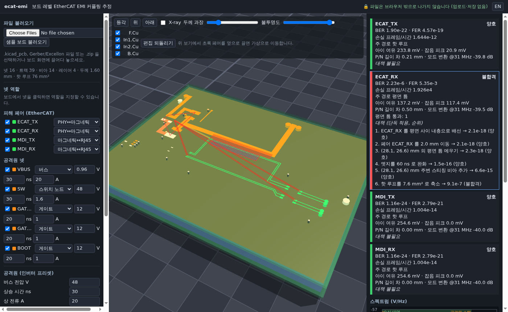

# ecat-emi

**한국어** · [English](#english)

보드 단위 EtherCAT EMI 추정기. 내 PCB 파일을 브라우저에 올리면 스위칭 노이즈가 EtherCAT 차동 페어에
어디서, 얼마나 결합되는지 3D로 보여 주고 BER/FER 판정과 순위가 매겨진 수정안을 제시한다.

> **파일은 브라우저를 떠나지 않는다.** File API로 메모리에서만 읽고, 업로드·서버·분석 도구·외부 폰트·
> 브라우저 저장소를 쓰지 않는다. URL 해시에는 설정값만 들어가고 보드 데이터는 절대 들어가지 않는다.

> **인증 시험을 대체하지 않는다.** 이 도구는 설계 비교용 준정적 근사 모델이다. EMC 적합성 시험(복사·전도 방출,
> 내성), EtherCAT 적합성(ETG Conformance) 시험, 실측 근접장 스캔이나 풀웨이브 해석을 대신하지 않는다.

## 사용 흐름

1. **불러오기** — `.kicad_pcb`, Gerber/Excellon 파일 여러 개, 또는 `.zip` 을 선택하거나 보드 뷰에 끌어다 놓는다.
   "샘플 보드" 버튼은 합성 4층 80×60 mm 보드(48 V 하프브리지 + EtherCAT PHY)를 연다.
   파싱 오류는 줄 번호와 함께 표시된다.
2. **넷 역할** — 피해(victim) 페어와 가해(aggressor) 넷이 이름 규칙으로 자동 제안된다
   (`TX±`, `*_P/*_N`, `ECAT*`, `MDI*` / `SW*`, `PHASE*`, `GATE*`, `VBUS`, `*_U/V/W` …).
   왼쪽 목록에서 켜고 끄고, 가해 넷마다 프리셋(스위치 노드 / 게이트 / 버스)과 ΔV, 상승 시간, 전류를 고친다.
   Gerber 는 넷이 없으므로 구리 섬을 클릭해 태그한다(같은 층 연결성 + 비아). 층 추정(X2 속성 → 확장자)은 직접 바꿀 수 있다.
3. **3D 보드 뷰 (WebGL2)** — 두께 과장 슬라이더가 있는 적층 단면, 층별 구리(표시 토글·불투명도), 비아, 패드.
   피해 페어는 초록, 가해 넷은 주황. 결합 구간은 노이즈 점유율로 색칠된 빛나는 띠로 그려지고, 마우스를 올리면
   ℓ, s, h, dB 기여를 보여 준다. 평면 틈은 빨간 빗금. 궤도/이동/확대(관성), 위·아래·등각 프리셋,
   더블클릭 초기화, X-ray(결합 영역만) 토글. WebGL2 가 없으면 2D 위쪽 뷰로 대체된다.
4. **드래그로 수정 시도** — 위쪽 뷰에서 피해 세그먼트를 옆으로 끌면 가상으로 이동하고 결과가 실시간 재계산된다.
   파일은 수정되지 않는다. "편집 초기화" 로 되돌린다. 수정안 목록 항목을 누르면 그 수정이 적용된다.
5. **결과 카드** — 페어별 판정 색, BER, FER, 시간당 손실 프레임, 지배 경로, 순위 수정안.
   스펙트럼·아이·버스트 타이밍 그래프는 선택한 페어/구간 기준.
6. **보고서** — Markdown / CSV 를 로컬에서 생성해 내려받는다(내 파일의 좌표와 넷 이름 포함, 전송 없음).
7. 한국어가 기본이며 KO/EN 전환 가능.

## 지원 형식과 한계

| 형식 | 지원 | 한계 |
|---|---|---|
| KiCad `.kicad_pcb` v6–8 | 적층, 넷, 풋프린트/패드, 세그먼트·아크, 비아, 채워진 존 | 커스텀 패드 모양은 경계 상자로 근사 |
| Gerber RS-274X + Excellon | D01/02/03, G01/02/03 + G75, 조리개 C/R/O/P, 영역 G36/37, LP, %FS/%MO, zip | 넷 정보 없음(클릭 태그), 매크로 조리개(AM)·step-and-repeat·블록 조리개 미지원(플래시 건너뜀) |
| Altium / Eagle 바이너리 | 지원 안 함 | Gerber 로 내보내서 사용 |

## 모델 (준정적 집중 상수 — 전자기 풀웨이브 해석 아님)

- 평행 구간: 10 mm 이내, 30° 이내, 같은 층 또는 인접 층의 세그먼트 쌍(균일 격자 이웃 탐색, O(n²) 아님).
- 결합 계수 `K = 1 / (1 + (s/h)²)` (용량성·유도성 공통), h = 적층에서 가장 가까운 기준 평면까지 높이.
- 가해 스펙트럼(단일 램프 에지): `V(f) = ΔV / (2πf) · min(1, 1/(π f t_r))`, 전류도 같은 형태.
- 구간별 근단/원단 결합: `g = sat(ωℓ/v)·Kℓ/ℓ`, 용량성 `g·V/2`, 유도성 `g·Z0·I/2` (Z0 = 50 Ω),
  NEXT/FEXT = `½·√((C+L)² + (C−L)²)`. P/N 차이가 차동 노이즈, 평균이 공통 모드.
- 모드 변환: `|CM→DM| = 10^(LCL/20) + 2|sin(π f Δt)|`, Δt = 페어 길이 차 × √((εr+1)/2) / c.
- 평면 틈: 기준 평면 존을 0.1 mm 로 래스터화, 페어가 빈 곳을 지나면 귀환 경로 루프
  (면적 = 틈 길이 × 페어 피치)에 `ωμ0·I/(2πr)·A` 유도.
- 핫 루프: 하이사이드 드레인, 로우사이드 소스, 입력 커패시터 패드의 볼록 껍질 면적 A.
  근접장은 소형 루프 쌍극자 `H = I·A/(4πr³)`.
- 마그네틱 이후(라인 측) 결합은 CMRR(기본 35 dB) 만큼 감쇠, PHY–마그네틱 사이는 감쇠 없음.
  수신 필터 2차 버터워스.
- 인접 층(브로드사이드) 결합: 같은 K 식에 3D 간격 `s = √(s_lat² + Δz²)` 사용, Δz = 적층의 층 간 거리.
  포화 함수 `sat(x) = x / √(1 + x²)`. 스티칭 비아가 있는 틈은 루프 가중 0.3, 높이도 공칭 쪽으로 70 % 회복.
- 케이블(보조 입력, 보드 간 케이블): `I_cm = C_cm · V_bus / t_r` (C_cm 기본 200 pF), 차폐·접지 설정 적용 후 CMRR 감쇠.
- 삽입 손실(100BASE-TX): `IL = (1.967·√f + 0.023·f + 0.050/√f) · L/100` dB (f in MHz),
  수신 필터 `|H| = 1 / √(1 + (f/f_bw)⁴)`.
- 구간들은 전력 합. 링크: 에지당 버스트 = t_r + 3τ, 노출 = 2·f_pwm·버스트,
  `Q = (eye/2 − peak)/σ`, `BER = 노출·Q→BER + (1−노출)·바닥`, `FER = 1 − (1−BER)^bits`.
  판정: BER < 1e-12 OK, < 1e-9 주의, 그 외 실패.

- 수정안 순위: 각 수정(페어 이동 — OK 에 도달하는 최소 0.5 mm 단위 간격, 틈 메우기, 스티칭 비아,
  핫 루프 축소 — OK 면적 이분 탐색, 에지 2배 느리게, 내층 배선)을 하나씩 적용해 모델을 다시 계산하고 BER 순으로 정렬.

결과는 설계 비교용 추정치이다. 측정이나 필드 솔버를 대체하지 않는다.

## 참고 문헌 (제목만)

- Clayton R. Paul, *Introduction to Electromagnetic Compatibility*
- Henry W. Ott, *Electromagnetic Compatibility Engineering*
- Howard Johnson, Martin Graham, *High-Speed Digital Design: A Handbook of Black Magic*
- Eric Bogatin, *Signal and Power Integrity — Simplified*
- IEEE 802.3, Clause 25 (100BASE-TX) / ANSI X3.263 (TP-PMD)
- IEC 61158 / IEC 61784 (EtherCAT)

## 스크린샷



## 빌드

```bash
cargo test
trunk build --release      # dist/, wasm ≤ 500 KB
bash tools/privacy_check.sh
```

---

<a id="english"></a>
## English

Board-level EtherCAT EMI estimator. Load your own PCB in the browser and see where and how much
switching noise couples into the EtherCAT pairs, in 3D, with BER/FER verdicts and ranked fixes.

> **Your file never leaves the browser.** It is read in memory with the File API. No upload, server,
> analytics, external fonts or browser storage. The URL hash holds settings only, never board data.

> **Not a substitute for certification testing.** This is a quasi-static approximation for comparing
> design options. It does not replace EMC compliance tests (radiated/conducted emission, immunity), EtherCAT
> conformance (ETG) testing, measured near-field scans, or a full-wave field solve.

### Workflow

1. **Load** a `.kicad_pcb`, several Gerber/Excellon files, or a `.zip` (file picker or drag-drop).
   "Load sample board" opens a synthetic 4-layer 80×60 mm board (48 V half-bridge + EtherCAT PHY).
   Parse errors show the line number.
2. **Net roles**: victim pairs and aggressors are auto-suggested from net names; edit them in the side
   list, with per-aggressor presets (switch node / gate / bus) for ΔV, rise time and current.
   Gerber has no nets: click a copper island to tag it. Layer guesses (X2 attributes, then extension) can be overridden.
3. **3D board view (WebGL2)**: extruded stackup with thickness exaggeration, copper per layer (toggle,
   opacity), vias, pads; victims green, aggressors orange; coupled runs as glowing bands coloured by
   noise share (hover: ℓ, s, h, dB); plane gaps as red hatch; orbit/pan/zoom with inertia, top/bottom/iso,
   double-click reset, X-ray. Without WebGL2 it falls back to a 2D top view.
4. **Drag to try a fix**: drag a victim segment sideways in the top view; results recompute live. The
   file is never edited. "Reset edits" undoes. Clicking a ranked fix applies it.
5. **Result cards** per pair: verdict colour, BER, FER, lost frames per hour, dominant path, ranked fixes;
   spectrum, eye and burst-timing plots for the selected pair or run.
6. **Report export** as Markdown or CSV, generated locally.
7. Korean by default, KO/EN toggle.

### Formats and limits

- KiCad 6–8: stackup, nets, footprints/pads, tracks and arcs, vias, filled zones. Custom pad shapes use their bounding box.
- Gerber RS-274X + Excellon (also zipped): D01–D03, G01–G03 with G75, apertures C/R/O/P, regions, LP, %FS/%MO. No nets (click to tag); aperture macros (AM), step-and-repeat and block apertures are not supported (those flashes are skipped).
- No Altium or Eagle binary formats: export Gerbers instead.
- No full-wave field solve. The model is quasi-static and lumped (formulas in the Korean section above:
  K = 1/(1+(s/h)²), single-edge spectrum, NEXT/FEXT weights, skew mode conversion, plane-gap return loop,
  hot-loop dipole, magnetics CMRR, Q-based BER with burst exposure; fixes ranked by re-running the model with each fix alone). Use it to compare layouts, not to sign off.

### References and screenshot

See the reference list and screenshot placeholder in the Korean section (titles only).

### Build

`cargo test`, `trunk build --release` (wasm ≤ 500 KB), `bash tools/privacy_check.sh`.
